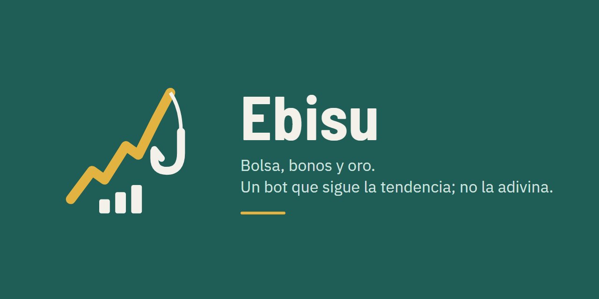

# Ebisu

Bot de inversion **sin apalancamiento** con activos que no son cripto: bolsa, bonos y oro, siguiendo la tendencia.
Proyecto personal, en construccion. **No es asesoramiento financiero.**

## Por que va al reves

El primer bot del autor (cripto) construyo toda la infraestructura antes de tener una estrategia con ventaja, y
despues de ~30 estudios ninguna estrategia activa ganaba. Ebisu sigue el orden contrario:

1. **Decisiones de fondo** (mercado, capital, apalancamiento, vehiculo, objetivo). **Hecho.**
2. **Estrategia probada con la historia**, con el criterio fijado y subido a git **antes** de medir: exploracion,
   reserva sin mirar (una sola vez) y un liston contra la suerte por el numero de variantes probadas. **En curso.**
3. **Solo si alguna estrategia pasa**, papel hacia adelante y despues el bot.

Si ninguna pasa, la conclusion es mantener un fondo indexado, sin bot.

## Estado

| Paso | Estado |
|---|---|
| Decisiones de fondo | Hechas (ocho decisiones) |
| Criterio del estudio 1 | Aprobado antes de medir; los cambios posteriores, anotados con fecha y motivo |
| Datos de bolsa, bonos, oro y monetario (2000-2026, en euros) | Listos y contrastados con fuentes oficiales |
| Simulador, juez y H2, validados con datos inventados | Hechos |
| Datos de divisas (Dukascopy, 7 pares) | Completos y contrastados con el BCE (13/10) |
| Medir la exploracion (una vez) | Pendiente de las divisas |
| Panel y Telegram | Solo disenyados: se construyen si una estrategia pasa |

## Documentos

| Documento | Que hay |
|---|---|
| [`docs/prd-paso-1.md`](docs/prd-paso-1.md) | Resumen de las decisiones de fondo |
| [`docs/decisiones/`](docs/decisiones/) | Cada decision, con el porque |
| [`docs/hipotesis.md`](docs/hipotesis.md) | La lista cerrada de hipotesis |
| [`docs/diseno-estudio-1.md`](docs/diseno-estudio-1.md) | El criterio del estudio, fijado antes de medir |
| [`docs/estudios/`](docs/estudios/) | Verificaciones (broker, fondos, datos) e inventario de datos |
| [`estudios/estudio1/`](estudios/estudio1/) | El codigo del estudio: datos, simulador, juez, medicion |
| [`assets/logo/`](assets/logo/) | El logo y la imagen para compartir |

## Reglas que no cambian

- Sin apalancamiento (1x): ni CFD, ni futuros, ni margen.
- La IA explica y puede frenar una compra; nunca comprar ni anyadir riesgo.
- Las claves, solo en un `.env` local que nunca entra en git. La API del broker no permite retirar dinero.

## Licencia

MIT. Ver [`LICENSE`](LICENSE).
